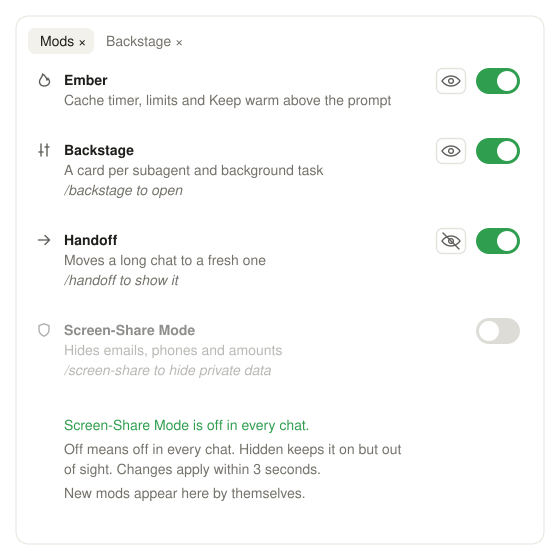

# Switchboard

**A Claude Code mod that puts every mod in one pane: what each one does, a switch to turn it off in every chat, and an eye to hide its panel while it keeps running.**

Once a few mods are installed it gets hard to remember which one draws what, and there is no quick way to turn one off in the middle of a chat. Type `/mods` and Switchboard opens the **Mods** pane.



> The image is an illustration, not a screenshot of the app.

Inspired by the Switchboard that Ben AI showed in his video *9 Insane Claude Mods I Already Can't live Without*. This is an independent version written from scratch; it shares no code with his.

## What the pane shows

- One row per mod: an icon, its name, a one-line description and, in italics, the slash command that opens it.
- **The switch.** Off means off in every chat: the mod is disabled for your user, as `/plugin` would do, and the open chat reloads its plugins. Switch it on again the same way.
- **The eye**, for a mod that draws a pane or a card above the prompt. Hidden keeps the mod running but out of sight: its card is left out of the cards above the prompt, and its panes no longer open.
- A line under the list saying what just changed.
- New mods appear by themselves: the list is read from what is installed each time the pane opens and every few seconds while it is open.

Every chat with Switchboard checks the switches every 3 seconds, so a change made in one chat reaches the others.

## Install

Switchboard needs a Claude Code build with mods (function hooks). It was built and tested on Claude Code 2.1.309.

At the prompt of a terminal session:

```
/plugin install switchboard --marketplace cyan119x/claude-code-switchboard
```

From a shell:

```bash
claude plugin install switchboard --marketplace cyan119x/claude-code-switchboard
```

In the desktop app, where `/plugin` does not run: click **+** next to the prompt box, then **Plugins**, **Add marketplace** with `cyan119x/claude-code-switchboard`, then **Add plugin**.

A session that was already open picks the mod up after `/reload-plugins`.

## How it works

| What | How |
| - | - |
| The list | `~/.claude/plugins/installed_plugins.json`, plus the marketplace folder of a local marketplace to find where each mod's code lives; only plugins with a hooks module count as mods. Mods loaded from a plugin folder (`--plugin-dir`) are seen through `plugin.register`. |
| Names, lines, hints | a short table for some known mods, else the first sentence of the mod's `plugin.json` description; the hint and the eye come from what its code registers (`command.register`, `ui.open`, the card above the prompt). |
| Off, for an installed mod | `claude plugin disable <mod>@<marketplace> --scope user` (and `enable`), run with the Claude Code binary of the session (`CLAUDE_CODE_EXECPATH`), then `/reload-plugins`. |
| Off, for a folder mod | its name in `~/.claude/switchboard.json`; Switchboard refuses it at `plugin.register`. |
| Hidden | its name in `~/.claude/switchboard.json`; Switchboard drops its card from the `band-stack` above the prompt and answers its `ui.open` with `isPlaced: false`; a pane already open is drawn as one line. |
| Other chats | each one reads `enabledPlugins` and `~/.claude/switchboard.json` every 3 seconds and reloads its plugins when the switches changed. |

The cards above the prompt follow the **band-stack** convention (a `Box` keyed `band-stack`, one keyed card per mod, sorted by rank), which is how Switchboard can tell one mod's card from another's.

## Limits

- Some hosts do not let a session run `/reload-plugins` (the desktop app over a remote connection, for one). There, a mod you switch off stays loaded in the open chat until it is reloaded or a new chat starts; the pane says so in a toast.
- Hiding works on mods whose hooks sit beneath Switchboard's in Claude Code's chain, which Claude Code decides, and on cards that follow the band-stack convention.
- A mod loaded from a plugin folder can only be refused when it loads after Switchboard.
- Claude Code's own panels (the Background tasks panel, for one) are not mods and cannot be hidden.

## Tests

```bash
claude plugin validate .
claude plugin test .
```

## License

MIT, see [LICENSE](LICENSE).
